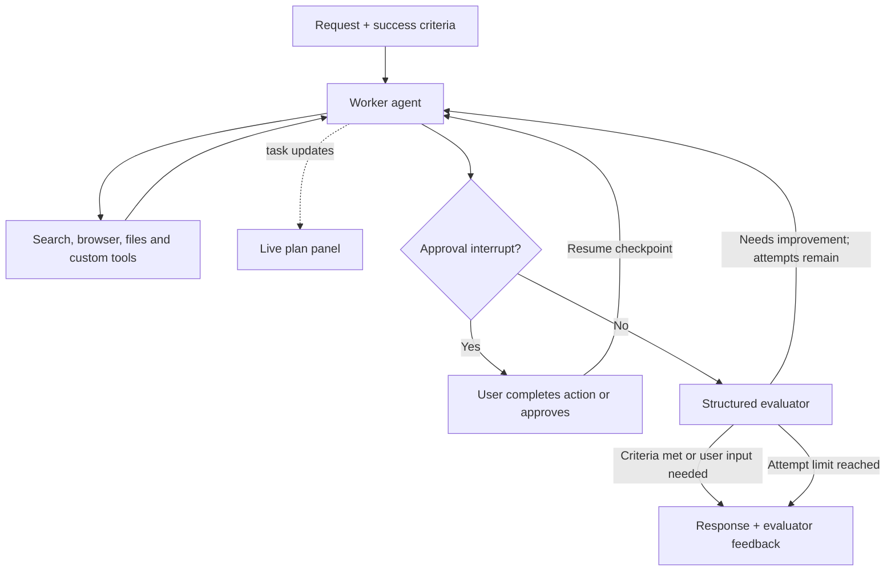

# Sidekick — a tool-using personal assistant

Sidekick is a local Gradio application that turns a request and explicit success criteria into a tool-driven workflow. It can research the web, interact with a visible browser, work with files, maintain a live task plan, and ask for human help. A separate LLM evaluator reviews the worker's response and can send it back for another attempt.

The project explores **agent orchestration, MCP integration, human-in-the-loop control, and evaluation-driven iteration**. It is an Operator-style learning prototype, not an implementation of OpenAI Operator or a production automation service.

## What it can do

| Capability | Implementation |
|---|---|
| Research questions | Google search through Serper and Wikipedia lookup tools |
| Browse and interact with websites | Playwright MCP server with a visible, isolated browser session |
| Read and write working files | Filesystem MCP server scoped to the repository's `sandbox/` directory |
| Show a live plan | `TodoListMiddleware` updates task state; Gradio polls it once per second |
| Work toward explicit acceptance criteria | The user supplies success criteria alongside the request |
| Review and revise an answer | A structured evaluator accepts the response, requests another attempt, or identifies a need for user input |
| Pause for a person | Approval interrupts for push notifications and requests for browser help |
| Send phone notifications | Pushover integration, requiring credentials and approval |
| Continue a conversation | In-memory checkpoints associated with a unique Sidekick session ID |

Example requests to try:

- “Compare three electric vehicles for a small delivery fleet. Save a concise recommendation under `sandbox/`.”
- “Find flight options for these dates and summarize the tradeoffs. Do not book anything.”
- “Research this topic using web search and Wikipedia, and save a briefing with source links.”

These are example tasks, not benchmarked guarantees. Website restrictions, authentication and tool failures can require user involvement.

## How the workflow runs



The worker chooses tools through LangChain's `create_agent`. The surrounding Python loop controls evaluation, retries, and pause/resume behavior. Both the worker and evaluator currently use **`gpt-5.4-mini`**, as configured in `sidekick.py`; your API project must have access to that model.

## Techniques implemented

### 1. Worker–evaluator orchestration

A single tool-using worker is wrapped in a custom evaluation loop. The evaluator returns a Pydantic schema with:

- `feedback`: concrete feedback on the response.
- `success_criteria_met`: whether to accept the result.
- `user_input_needed`: whether clarification or human involvement is needed.

If the response is insufficient, the evaluator's feedback becomes the next worker instruction. The loop permits up to **three evaluated attempts**. Reaching that limit returns the latest response and feedback; it does not certify success.

### 2. Stateful execution with LangGraph checkpoints

`InMemorySaver` and a per-session UUID preserve worker state across turns and approval pauses. `Command(resume=...)` continues the paused workflow. Reset creates a new Sidekick instance and requests cleanup of the old MCP sessions.

This is process-memory state, not durable memory. Although `memory.db` is present in the repository, the current application does not use it as its checkpointer.

### 3. Persistent MCP tool sessions

The app connects to two subprocess-based MCP servers over standard input/output:

- **Playwright:** `@playwright/mcp@latest --isolated`.
- **Filesystem:** `@modelcontextprotocol/server-filesystem`, restricted to `sandbox/`.

A background asyncio task owns both connections through `AsyncExitStack`. Keeping these sessions open allows browser state to persist between tool calls and keeps connection cleanup in the task that opened them.

### 4. Middleware-based controls

| Middleware | Purpose and boundary |
|---|---|
| `TodoListMiddleware` | Gives the worker a task plan that is also visible in the UI |
| `PIIMiddleware` | Configures email handling and credit-card handling, including credit-card checks on tool results; not a comprehensive privacy guarantee |
| `ModelCallLimitMiddleware(run_limit=30)` | Limits worker model calls per run; not a task-wide dollar cap, and evaluator calls are separate |
| `HumanInTheLoopMiddleware` | Interrupts `send_push_notification` and `request_human_help` |
| Custom `TolerateToolErrors` | Converts tool exceptions into messages the worker can use to try another approach |

The approval button approves the pending actions. Other browser and filesystem tools are **not** automatically approval-gated by this configuration.

### 5. Asynchronous Gradio interface

The UI includes chat, a separate success-criteria field, a live plan panel, Reset, and an approval button. A timer is the plan panel's only writer, allowing task updates to remain visible while a longer worker request is running. The Go button is enabled after setup finishes loading the MCP tools.

## Run locally

### Prerequisites

- Python with support for the installed LangChain and Gradio releases. Python 3.11+ is a reasonable starting point; this repository does not declare or test a compatibility matrix.
- Node.js and npm, including `npx`, for the MCP servers.
- An OpenAI API key with access to the configured model.
- A Serper API key. The search wrapper is created when `sidekick_tools.py` is imported, so configure it before starting the app.
- Pushover application/user credentials if you want notifications.
- A desktop environment for the visible browser. This is not currently packaged as a headless public deployment.

### 1. Clone and install dependencies

There is currently no checked-in dependency manifest or lockfile. The following bootstrap commands are derived from the source imports; dependency versions are not reproducibly pinned.

```bash
git clone https://github.com/rudrakshsyal/the_sidekick_agent.git
cd the_sidekick_agent
python3 -m venv .venv
source .venv/bin/activate
python -m pip install 'gradio>=6,<7' 'langchain>=1,<2' langchain-openai \
  langchain-community langchain-mcp-adapters langgraph pydantic \
  python-dotenv requests wikipedia
```

On Windows, activate with `.venv\Scripts\activate` instead. The optional notebook and slide helper additionally need `jupyter`, `ipykernel`, and `python-pptx`.

### 2. Configure local credentials

Create a `.env` file in the repository root:

```dotenv
OPENAI_API_KEY=your_openai_api_key
SERPER_API_KEY=your_serper_api_key

# Needed only for phone notifications
PUSHOVER_TOKEN=your_pushover_application_token
PUSHOVER_USER=your_pushover_user_key
```

`.env` is ignored by Git. Do not put real credentials in source files, notebooks, prompts or committed outputs. The code uses `load_dotenv(override=True)`, so values in `.env` override matching existing environment variables.

### 3. Start the app

```bash
python app.py
```

Gradio opens a local browser page. Wait for **Go!** to become active, enter a request and success criteria, then submit. MCP startup may download Node packages. If Playwright reports a missing browser, follow its browser-installation instructions before retrying.

For a human-help pause, complete the requested action in the automation browser and then select **Approve and continue**. Reset starts a new conversation but does not delete files already saved in `sandbox/`.

**API usage is paid according to your providers.** Worker calls, evaluator calls and retries all contribute to usage. The current code has no monetary budget ledger or hard spending cap.

## Repository guide

| Path | Responsibility |
|---|---|
| `app.py` | Gradio layout, events, session state, approval controls and plan polling |
| `sidekick.py` | Worker setup, middleware, evaluator schema, retry loop and checkpoint resume |
| `sidekick_tools.py` | Search, Wikipedia, Pushover, human-help tool and MCP session lifecycle |
| `styles.py` | Gradio theme, custom CSS and page styling assets |
| `5_lab5.ipynb` | Exploratory notebook demonstrating agent and approval workflows |
| `sandbox/` | Working files and included example outputs |
| `sandbox/skills/fleet-slide/SKILL.md` | Instructions for a fictional Voltway Research recommendation slide |
| `slide_kit.py` | `python-pptx` helper for creating a branded, single-slide deck |
| `memory.db` | Included database file; not used by the current in-memory checkpoint implementation |

### Slide-generation status

The repository includes a slide template, logo, skill instructions and an example `sandbox/fleet.pptx`. However, `get_all_tools()` does **not** register a `create_slide` tool or connect `slide_kit.build_slide` to the worker. Treat this as a supporting artifact/helper, not an available end-to-end capability of the main app. The skill text alone does not register or execute a tool.

## What the evaluator does—and does not—prove

The evaluator sees the request, success criteria, latest worker reply, and tool-call **names** collected from the checkpoint's message history. It does not independently inspect tool results, browser state or generated files. That history can include calls from earlier turns, and a tool-call name does not prove that the action succeeded.

This implements **LLM-based self-review**, not an independent factual verifier or a measured accuracy benchmark. The repository does not currently include an automated test suite or quantitative evaluation results.

## Current limitations and useful next steps

- **Local prototype:** no authentication, public-hosting configuration or production monitoring is provided.
- **Shared files:** conversation IDs are separate, but all sessions use the same `sandbox/` directory. This is not multi-user filesystem isolation or an operating-system sandbox.
- **Partial approval coverage:** browser actions can have external effects without triggering either of the two configured approval gates.
- **No hard cost cap:** retries and evaluator calls add usage beyond the worker's per-run limit.
- **Unpinned tooling:** Python dependencies have no lockfile, and MCP packages are resolved without fixed versions.
- **Limited verification:** add result-level evidence checks and repeatable task evaluations before relying on completion claims.
- **Extension opportunity:** register the slide helper as a tool if presentation creation should become part of the main workflow.

## Learning context and license

The source and notebook contain course/lab references, including Edward Donner's course website in the Wikipedia user-agent string. This repository presents the implemented learning project and its current behavior; it does not claim to reproduce a commercial Operator product.

Licensed under [Apache License 2.0](LICENSE).
